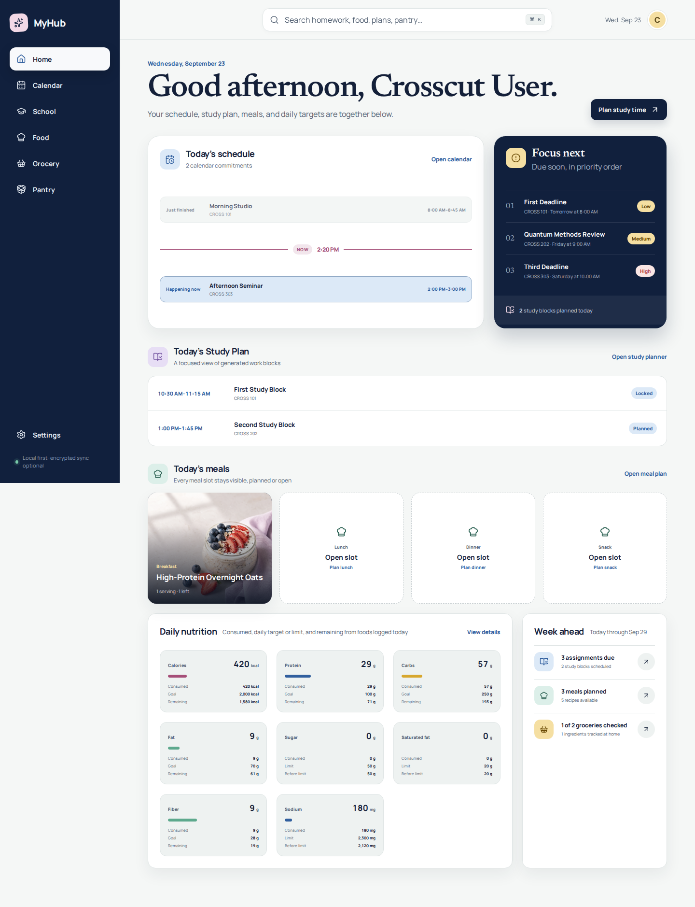
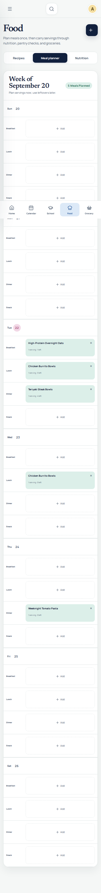
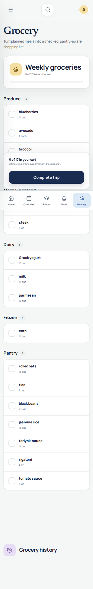

# MyHub

MyHub is a private, web-first college planner for calendars, homework, study time, recipes, meals, nutrition, pantry inventory, groceries, and a Closet Planner. It runs on desktop and can be installed as a free Home Screen web app on a phone or tablet. A separate, incomplete native SwiftUI application lives in `native/`.

**[Open MyHub](https://avicados14.github.io/MyHub/)** · **[Phone installation and sign-in guide](docs/PHONE_INSTALL_GUIDE.md)** · **[Grocery sharing and cooking guide](docs/GROCERY_SHARING_AND_COOKING.md)**

## Install on your phone and connect your data

1. On iPhone/iPad, open MyHub in Safari and choose **Share → Add to Home Screen**. Leave **Open as Web App** enabled if shown. On Android, use Chrome's **Install app** or **Add to Home screen** option.
2. Open MyHub from its new Home Screen icon **before connecting**. The installed app and the browser may use separate storage.
3. On an already-connected device, open **Settings → Install MyHub / connect a device**. Resume sync if paused and wait until its status is **current**, then choose **Generate sign-in code**.
4. On the new device, open the same page, enter the 16-character code, check **I want to load my synced data on this device**, and choose **Connect this device**.
5. Confirm your records appear. If the device already has unsynced work, export it before connecting: connection replaces its local AppData with the synced copy.

Codes expire after 10 minutes and work once. Spaces and hyphens are optional. Generating another code cancels the previous pending code. Keep codes private. If connection fails after redemption, generate a new code on the connected device.

The existing device must have active private access; a manually configured GitHub backup connection alone is insufficient. Open its existing private access link or follow the Settings recovery flow. **Do not routinely create replacement private links to add devices:** replacement revokes the shared capability used by existing devices. Use a sign-in code instead.

No paid Apple hosting, Apple Developer membership, App Store, or TestFlight distribution is required for this web-app path. GitHub and Supabase service quotas still apply. Full installation, recovery, offline, and update instructions are in the [phone guide](docs/PHONE_INSTALL_GUIDE.md).

## Features and boundaries

### Calendar, school, and study planning

- Day, week, and month calendars; manual event creation, editing, and deletion.
- Previewed, confirmed multi-file `.ics` imports with UTC/TZID conversion into the configured calendar time zone, DST-aware recurrence, exclusions, stable deduplication, and Canvas homework mapping.
- Editable homework, subtasks, progress, source links, and imported provenance.
- Deterministic study scheduling through deadlines with preferred hours, breaks, and avoid-time ranges. Locked, completed, moved, or resized study blocks remain protected.
- Keyboard-operable forms and 15-minute resize controls alongside pointer drag-and-drop.

### Food, meals, and cooking

- Structured recipe editing, serving scaling, US/metric conversion, and reviewable import drafts from supported URL JSON-LD, pasted text, local image OCR, or user-supplied social content.
- Weekly planning for recipes, packaged foods, custom foods, and leftovers. Planned, prepared, and consumed amounts remain separate. Linked meal-prep days share one decreasing batch balance.
- Barcode/text lookup through Open Food Facts, reviewed Nutrition Facts OCR, immutable food-log snapshots, and eight nutrition metrics. Planning a meal does not record it as eaten.
- **Start cooking** on a recipe, or **Cook recipe** on a planned recipe meal, opens scaled ingredients, checkboxes, step navigation, and notes. Cooking progress is temporary and does not modify consumption or leftovers. **Keep screen awake** depends on browser/device support.

### Pantry, groceries, and sharing

- Pantry, refrigerator, and freezer inventory.
- Current-week grocery aggregation using compatible units, prepared servings, and recipe overrides; explicit Pantry Check and staple review; editable shopping; confirmed-purchase pantry updates; immutable trip history.
- **Share grocery list** previews the list and offers **Email list**, **Text list**, **Copy list**, and native sharing where supported. Email/SMS actions open drafts; you choose the recipient and send in your own app. MyHub does not automatically deliver messages. Purchased items are excluded unless selected.

### Closet Planner

- Import a ZIP or individual garment photos, review exact/likely duplicates, edit metadata, and preserve stable numerical garment IDs.
- Rule-based suggestions from clean garments, occasion, and available Fahrenheit weather. Golden, Colorado is the default; device location is optional and requested only when selected.
- **Save outfit & mark dirty** saves a dated immutable garment snapshot and immediately marks selected garments dirty, including future-dated plans. **Run laundry** marks garments clean. There is currently no separate “mark worn later” workflow.
- Private Supabase photo storage and owner/session-protected wardrobe/history tables. Closet data is separate from encrypted AppData and requires a network connection.
- **Export JSON** exports wardrobe/history metadata, not image files. It is separate from Settings' AppData backup; a complete photo backup/restore flow is not implemented. Smart Suggest uses an optional server-side Google Gemini integration and falls back to regular suggestions until configured. See [secure activation](docs/CLOSET_SETUP.md#smart-suggest-activation).

See [Closet setup and privacy](docs/CLOSET_SETUP.md), [architecture](docs/CLOSET_PLAN.md), and the dated [verification report](docs/CLOSET_VERIFICATION.md).

### Shared application behavior

Responsive light/dark layouts, a connected dashboard, universal search across the six core academic/food collections, IndexedDB persistence, versioned backup validation/migration, confirmed data replacement, encrypted AppData sync, and encrypted GitHub backup. Fresh installs contain **no personal recipes, assignments, or wardrobe** until data is imported or connected.

## Storage, sync, and privacy

There are two different storage models:

| Data                                                                                     | Local/cloud storage                                                         | Protection and backup                                                                                                                                                    |
| ---------------------------------------------------------------------------------------- | --------------------------------------------------------------------------- | ------------------------------------------------------------------------------------------------------------------------------------------------------------------------ |
| Core AppData: calendar, homework, recipes, meals, nutrition, pantry, groceries, settings | Immediate IndexedDB cache; primary Supabase document; private GitHub backup | Client-side AES-256-GCM encryption, PBKDF2-SHA-256 with 310,000 iterations. Supabase and GitHub receive ciphertext for these documents.                                  |
| Closet garments, outfit snapshots, and photos                                            | Supabase tables and private Storage bucket                                  | Supabase Auth, ownership policies, and immutable session-to-private-link binding. **Not client-side end-to-end encrypted** and not included in AppData/GitHub snapshots. |
| Settings JSON export                                                                     | Downloaded file                                                             | Plaintext core AppData; validated/migrated on import. Excludes sync credentials and Closet Planner data.                                                                 |
| Closet JSON export                                                                       | Downloaded file                                                             | Plaintext garment/history metadata, including image paths; excludes photo bytes and sync credentials.                                                                    |

A private link contains a random record ID and a browser decryption/write key in its URL fragment. Opening it resolves and decrypts AppData, configures encrypted backup, removes the capability from the active address, and opens Home. Device codes transfer this same capability in an encrypted, temporary package; they do not create independently revocable device accounts. Replacing a private link revokes access for all devices using it. Unlink removes the local connection only.

Core capability/pairing tables deny direct client access; narrow Edge Functions validate capabilities and enforce optimistic revision writes. Concurrent stale edits are blocked rather than silently overwriting newer data. Closet Planner exchanges an active MyHub capability for a Supabase Auth session; its RLS checks that session's original, still-active link. See [access architecture](ACCESS_ARCHITECTURE.md) and [Closet setup](docs/CLOSET_SETUP.md).

GitHub backup targets the private `avicados14/MyHub-Data` repository at `myhub-data/v1/snapshot.enc`, with conditional SHA writes and explicit conflict handling. For manual recovery setup, use a fine-grained token limited to that repository with **Contents: read and write**, plus the existing encryption passphrase. Do not grant workflow/admin permissions or use a classic PAT. Credentials remain separate from AppData and exports.

MyHub includes no advertising, behavioral analytics, or marketing software. Core calculations and OCR run in the browser. External lookups, weather, Supabase Auth/Storage, and GitHub requests still contact their respective services. A compromised browser can access decrypted records and credentials while the app is active. Keep private links, codes, plaintext exports, and calendar-feed URLs private.

### Calendar refresh paths

- **Settings → Refresh feed:** a direct browser fetch. Canvas/provider CORS restrictions can block it.
- **Scheduled encrypted snapshot:** the separate private MyHub-Data workflow fetches feeds every 30 minutes. With unlocked GitHub access, Calendar imports `myhub-data/v1/calendars.enc` on open, explicit check, and every 15 minutes while open. The producer does not itself push AppData to Supabase; the browser's ordinary encrypted sync propagates imported records.
- **Manual ICS import:** privately download an export, preview it in Calendar, and confirm. This is the fallback when direct fetching fails.

Historical personal-data counts and their verification limits are recorded in [the September continuation report](docs/CONTINUATION_2026-09-28.md); they are not current live-data guarantees.

### Offline use, updates, and clearing data

After a successful online load and service-worker installation, the production app can reopen its cached shell and local AppData offline. Sign-in, synchronization, Closet Planner, weather, remote images/lookups, and first-time OCR downloads require a connection. Temporary connection failures retain the saved private-access credential. Close all app windows and reopen online to activate a waiting update.

**Settings → Data & privacy → Clear all data** empties core AppData after confirmation. If connected, that empty state propagates to Supabase and GitHub; this is **not merely a local cache reset**. Connection settings remain. It does not erase Closet Planner tables/photos or historical Git commits. Export before clearing. Browser storage removal can discard unsynced local changes; the last synced document remains recoverable through an active link or connected device.

## Development

Requirements: Node.js 22+, npm, and Git.

```bash
git clone https://github.com/avicados14/MyHub.git
cd MyHub
npm ci
npm run dev
```

Open the address Vite prints, normally `http://localhost:5173`. Build with `npm run build`; preview with `npm run preview`. `dist/` contains the generated site and service worker. `GITHUB_ACTIONS=true` selects the `/MyHub/` base path for GitHub Pages.

### Tests

```bash
npm run check
npx playwright install --with-deps chromium webkit
npm run test:e2e
```

`npm run check` validates generated portable contracts/Swift models, formatting, lint, actual TypeScript projects, unit tests, and the production build. Browser tests use desktop/tablet/mobile Chromium plus iPhone WebKit device pairing. Network-dependent acceptance tests use synthetic fixtures and mocked services.

To test production Home Screen/offline behavior at the expected Pages path:

```bash
GITHUB_ACTIONS=true npm run build
npx playwright test --config=playwright.pwa.config.ts
```

The offline suite runs Chromium and WebKit, stops the test origin, proves uncached requests fail, then checks cached navigation. This is browser-engine evidence, not physical iPhone installation acceptance. PowerShell users should set `$env:GITHUB_ACTIONS='true'` before running the build.

For Swift tests and simulator build commands, see [native/README.md](native/README.md). They require a Mac/Xcode; GitHub's native workflow runs them on macOS. Current results belong to the relevant commit's CI run and dated work log, not the historical totals in `REQUIREMENTS_AUDIT.md`.

### Deployment

[`.github/workflows/pages.yml`](.github/workflows/pages.yml) validates pull requests and main pushes with static checks, unit tests, production build, two offline-install cases, and the full browser matrix. Only main/non-PR runs publish Pages after validation. Configure **Settings → Pages → GitHub Actions**. The separate native workflow validates Swift tests and an unsigned iPhone/iPad simulator build.

### Repository map

| Location                                        | Responsibility                                                                               |
| ----------------------------------------------- | -------------------------------------------------------------------------------------------- |
| `src/app/`, `src/components/`, `src/styles/`    | Persistent app context, routing, shell, shared UI, responsive styling                        |
| `src/domain/`, `src/storage/`, `src/utilities/` | Models/calculations, migrations, IndexedDB/backup validation, shared helpers                 |
| `src/sync/`                                     | Encrypted AppData, GitHub backup, private-access/device-code orchestration                   |
| `src/features/`                                 | Dashboard, calendar, school, food/cooking, pantry, grocery/sharing, closet, settings/devices |
| `supabase/`                                     | Broker/closet functions, migrations, SQL authorization tests                                 |
| `tests/`, `tests-pwa/`                          | Browser workflows and production offline-install tests                                       |
| `contracts/`, `native/`                         | Portable contracts/fixtures and native SwiftUI foundation                                    |
| `public/`, `docs/`                              | Static assets/icons/manifest, guides, dated screenshots and verification records             |

## Native app and remaining acceptance

The native SwiftUI foundation already includes navigation, offline storage/import/export, dashboard, event/homework editing, study planning, recipe viewing/scaling, and reviewed export through Apple's event editor. It is **not the Home Screen web app**. Native enrollment/sync, complete feature parity, and physical-device/accessibility acceptance remain incomplete. See [native README](native/README.md), [iOS plan](MYHUB_IOS_PLAN.md), [decisions](docs/NATIVE_DECISIONS.md), [TODO](TODO.md), and [FIXME](FIXME.md).

Physical iPhone installation, the owner's installed email/SMS apps, wake-lock behavior, and live personal-calendar propagation still need device acceptance. Automated mocked browser passes do not prove those interactions. Recipe URL/OCR/import quality and remote services remain subject to CORS, network availability, and review of imported values.

## Screenshots

These are illustrative fixture screenshots, not personal account contents or a guarantee of the latest release layout. See the dated work log for the scope of visual review.







### Personal wardrobe and temperature rules

Closet Planner supports garments before photos are available, active feels-like-low temperature bands, and color-coordinated clean-only suggestions. Later photo attachments preserve garment IDs and history. Configure bands in Settings → Clothing profile and review garment types/preferences in Closet Planner. See [Clothing profile guide](docs/CLOTHING_PROFILE.md).

### Startup and School loading

Planner data is loaded once from IndexedDB and shared across pages. A saved private
connection restores the encrypted primary copy before editing is enabled, preventing
late cloud restores from overwriting new edits. Cloud requests time out after 15
seconds so an unavailable broker does not leave startup loading indefinitely; the
saved local copy remains available. Reload to retry the connection.

GitHub backup verification runs after primary hydration and does not block page
access. School preloads in the background after startup and displays homework in
batches of 20; **Show more homework** reveals the remaining assignments without
removing any records. Failed page imports display a **Reload MyHub** action.
